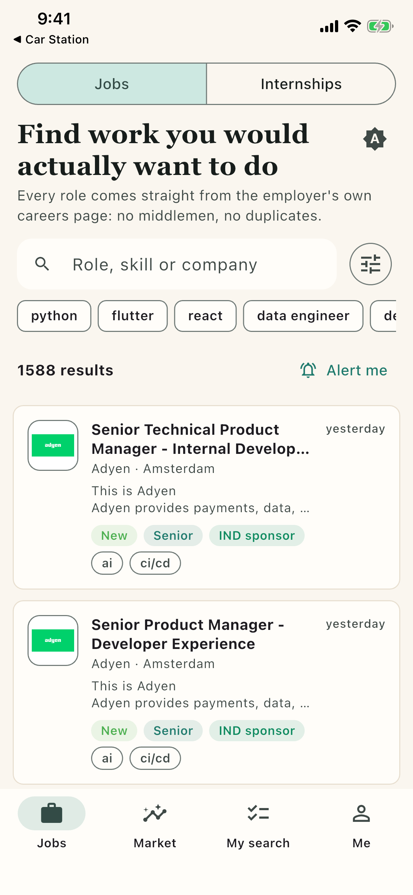
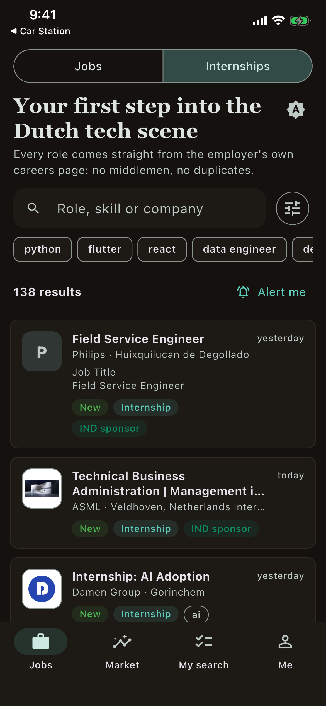
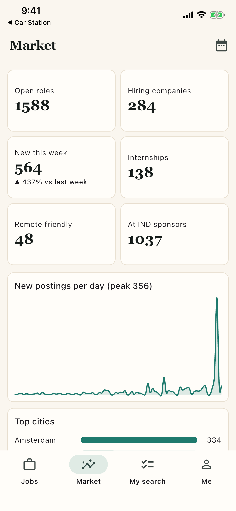
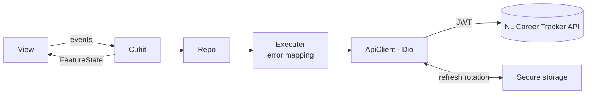

<div align="center">

# 📱 NL Career Tracker, Mobile

### Dutch tech jobs and internships, straight from the employers' own career pages. In your pocket.

*No aggregators, no duplicates, no stale listings. Your pipeline, alerts and Gmail replies in one calm place.*


-1f7a6d)


The mobile client of **[NL Career Tracker](https://github.com/emelian-chkaira/nl-career-tracker)**. Same API, same plain warm design as the web app.

**[Quick start](#-quick-start)** · **[Why use it](#-why-youll-like-it)** · **[Screenshots](#-see-it)** · **[Features](#-what-you-can-do)** · **[Tech stack](#-tech-stack)** · **[Architecture](#-architecture)**

</div>

---

## ⚡ Quick start

The backend has a one-click installer that also loads ready-made data (Dutch tech companies, open listings, the IND sponsor register):

```bash
git clone https://github.com/emelian-chkaira/nl-career-tracker.git
cd nl-career-tracker && ./setup.sh          # API on http://localhost:8787
```

Then, in this repo:

```bash
flutter pub get
flutter run --dart-define=API_URL=http://localhost:8787
```

## 💚 Why you'll like it

- 🎯 **Only real, current roles.** Every listing comes from the company's own careers page, so there is nothing to wade through.
- 🛂 **Built for people moving to the Netherlands.** IND-sponsor badges, "English OK / Dutch required", salary checks.
- 🗂 **One place for the whole search.** Jobs and internships behind a single switch; pipeline, alerts and the Gmail inbox together under **My search**.
- 📬 **Your inbox sorted for you.** Interview invites, tests, offers and rejections found in Gmail (read-only) and linked to your pipeline.
- 🔒 **Private by design.** Self-hosted backend, tokens in the system keychain, no tracking.
- 🌗 **Calm and readable.** A flat, warm design with serif headings, light and dark.

## ✨ See it

<table>
  <tr>
    <td align="center"><br><sub><b>Jobs</b> · light</sub></td>
    <td align="center"><br><sub><b>Jobs</b> · dark</sub></td>
  </tr>
  <tr>
    <td align="center"><br><sub><b>Internships</b> · one switch away</sub></td>
    <td align="center"><br><sub><b>Market</b> · live stats and charts</sub></td>
  </tr>
</table>

> Screenshots come from the iOS Simulator against the author's development data. Pipeline, Alerts and Inbox need a signed-in account, so they are not shown here.

## 🚀 What you can do

| | |
|---|---|
| 🔎 **Search** | One search box with the same engine as the web (keyword, semantic and hybrid), quick-chips and a filters sheet (sort, posted date, remote-friendly, IND sponsors only). |
| 🎓 **Jobs / Internships** | A switch at the top of the first tab, no extra tab needed. |
| 🛂 **Sponsor + salary badges** | IND-sponsor status per employer; "Dutch required" / "English ok" per posting. |
| 📊 **Market** | KPI tiles, postings per day, top cities and companies, contract types, skill demand (`fl_chart`). |
| 🗂 **My search** | Three tabs in one screen: **Pipeline** (saved → applied → interview → offer, with notes), **Alerts** (saved searches) and **Inbox**. |
| 📬 **Inbox** | See the events found in your Gmail (applications, interviews, tests, offers, rejections), accept or dismiss them, and start a sync. Connecting Gmail itself is done once on the web, where Google's sign-in page opens. |
| 📄 **CV tools** | Import your CV, tailor it to a job, export and share the LaTeX/PDF, draft a cover letter. |
| 👤 **Accounts** | Sign in / sign up, **Continue with Google**, forgot password, e-mail verification. Tokens live in Keychain / Keystore. |
| 🌗 **Light & dark** | Follows the system, or toggle from the header. |

## 🏗 Architecture

A **feature-first Cubit** architecture (the Metagate template):

```
lib/
├─ app/
│  ├─ features/<feature>/{cubit, models, repo, view}   auth · jobs · companies · alerts · dashboard · pipeline · inbox · my · cv · profile
│  └─ global/widgets                                   shared widgets (TryAgain, Pill, Section, SignInPrompt …)
└─ core/
   ├─ api/            Dio ApiClient · endpoints · interceptors (auth header, refresh-token rotation, errors) · Executer
   ├─ base_states/    FeatureState · Status · PaginatedState
   ├─ database/       secure token storage
   ├─ routes/         AppRouter           ├─ styles/   theme, HeroBanner, ThemeController
   └─ utils/          get_it dependency registration
```



Every screen has a **loading / loaded / failed** state with a *Try again* action, and server errors are mapped to friendly messages (`CustomDioException`).

## 🧰 Tech stack

| Concern | Choice | Why |
|---|---|---|
| UI | **Flutter** (Material 3), custom flat warm theme, serif headings | One codebase for iOS and Android |
| State management | **flutter_bloc** (Cubit) + **equatable** | Predictable, easy to test |
| Networking | **Dio** with interceptors: bearer token, **automatic refresh-token rotation**, error mapping | Sessions that survive real life |
| Dependency injection | **get_it** | Simple, no code generation |
| Secure storage | **flutter_secure_storage** (Keychain / Keystore) | Tokens never in plain preferences |
| Charts | **fl_chart** | Native-feeling market dashboard |
| Auth | Backend sessions over **Firebase Authentication**; **google_sign_in** | E-mail and Google sign-in |
| Links and files | `url_launcher`, `file_picker`, `path_provider`, `share_plus` | Open applications, import and export CVs |
| Logging | `talker` | Readable network logs |
| Quality | `flutter_lints`, `flutter analyze`, unit tests, GitHub Actions CI | |

**The backend behind it:** Python 3.13 · FastAPI · PostgreSQL 16 + pgvector · Playwright crawler · Gmail API · Docker. See the [main repo](https://github.com/emelian-chkaira/nl-career-tracker) for the full stack.

## 🏆 Highlights

- 🎨 A coherent design system shared with the web: flat surfaces, thin lines, teal and amber accents, serif headings, light and dark themes.
- 🔐 Token refresh with rotation happens transparently in the Dio interceptor; sign-out revokes the session; the Google button only appears when the server has Google configured.
- 🧱 Clean boundaries: views never touch Dio, cubits never build requests, repos return models.
- 🔁 Web and mobile stay in sync: same four areas (Jobs, Market, My search, Me) and the same wording.

## ⚡ Run it

```bash
flutter pub get
flutter run --dart-define=API_URL=http://localhost:8787
```

| Target | `API_URL` |
|---|---|
| iOS Simulator | `http://localhost:8787` |
| Android emulator | `http://10.0.2.2:8787` |
| Real phone | your computer's LAN IP, or your deployed `https://…` URL |

The API comes from the [backend repo](https://github.com/emelian-chkaira/nl-career-tracker). Its **one-click installer** (`./setup.sh`) starts everything and loads ready-made data, so the app has jobs to show the first time you open it.

### Sign in with Google (optional)

1. Set up Firebase and the OAuth clients as described in the backend repo's [`docs/FIREBASE.md`](https://github.com/emelian-chkaira/nl-career-tracker/blob/main/docs/FIREBASE.md).
2. iOS: add the reversed client ID as a URL scheme in `ios/Runner/Info.plist` and build with `--dart-define=GOOGLE_IOS_CLIENT_ID=<iOS client ID>`.
3. Android: create an Android OAuth client with package `nl.careertracker.career_tracker` and your signing key's SHA-1.

The button appears automatically once the server reports a Google client ID.

## 🧪 Quality

```bash
flutter analyze
flutter test
```

CI (`.github/workflows/ci.yml`) runs `flutter pub get` and `flutter analyze` on every push.

## 🚧 Status

The iOS app has been run and checked on the iOS Simulator. Not yet verified: Android builds, the Google button against a live Google client, and the CV import / export screens on a physical device.

## 📚 More

Backend, web app, crawler and deployment guides: **[nl-career-tracker](https://github.com/emelian-chkaira/nl-career-tracker)**.
