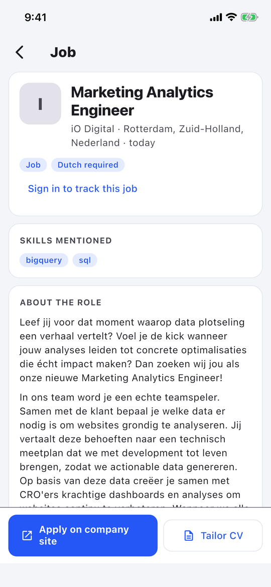
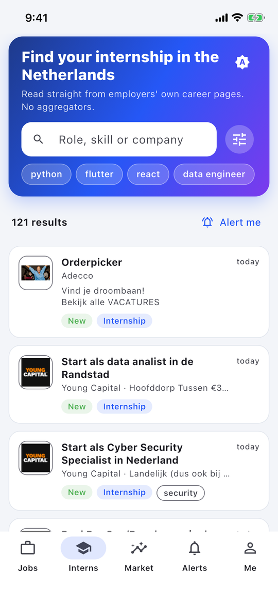
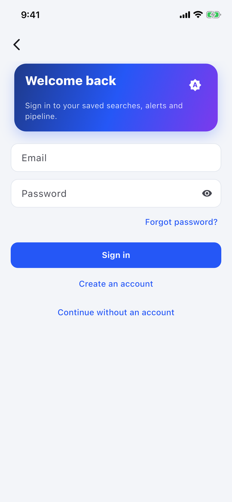
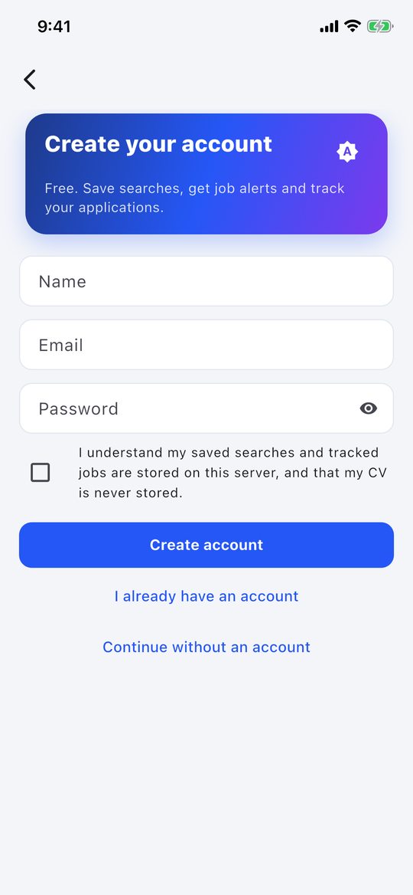
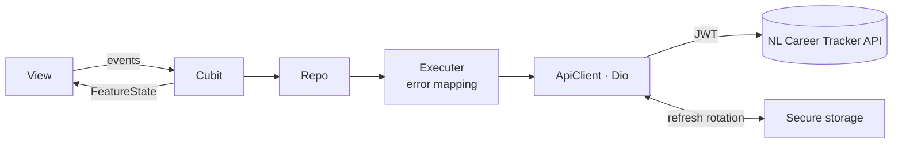

<div align="center">

# 📱 NL Career Tracker — Mobile

### Search Dutch tech jobs and internships, straight from the employers' own career pages. In your pocket.


-7C3AED)


The mobile client of **[NL Career Tracker](https://github.com/emelian-chkaira/nl-career-tracker)** — it talks to the same API as the web app.

</div>

---

## ✨ See it

<table>
  <tr>
    <td align="center"><br><sub><b>Jobs</b> · light</sub></td>
    <td align="center"><br><sub><b>Jobs</b> · dark</sub></td>
    <td align="center"><br><sub><b>Job detail</b> · apply or tailor your CV</sub></td>
  </tr>
  <tr>
    <td align="center"><br><sub><b>Internships</b> · own tab</sub></td>
    <td align="center"><br><sub><b>Market</b> · live stats and charts</sub></td>
    <td align="center"><br><sub><b>Sign in</b> · e-mail, forgot password</sub></td>
  </tr>
  <tr>
    <td align="center" colspan="3"><br><sub><b>Create account</b> · consent, show/hide password</sub></td>
  </tr>
</table>

> Screenshots come from the iOS Simulator against the author's development data (18 Nov 2026).

## 🚀 What you can do

| | |
|---|---|
| 🔎 **Search** | One search box with the same engine as the web (keyword, semantic and hybrid), quick-chips, and a filters sheet (sort order, posted date, remote-friendly, recognised IND sponsors only). |
| 🎓 **Internships** | A dedicated tab for internships and traineeships. |
| 🛂 **Sponsor + salary badges** | Every employer shows its IND-sponsor status; "Dutch required" / "English ok" is detected per posting. |
| 📊 **Market** | KPI tiles, postings per day, top cities and companies, contract types and skill demand (`fl_chart`). |
| 🔔 **Alerts** | Save a search, get notifications for new matches. |
| 🗂 **Pipeline** | Track saved → applied → interview → offer, with notes. |
| 📄 **CV tools** | Import your CV, tailor it to a job, export and share the LaTeX/PDF, draft a cover letter. |
| 👤 **Accounts** | Sign in / sign up, **Continue with Google**, forgot password, e-mail verification. Tokens are kept in the system keychain / keystore. |
| 🌗 **Light & dark** | Follows the system, or toggle from the header. |

## 🏗 Architecture

A **feature-first Cubit** architecture (the Metagate template):

```
lib/
├─ app/
│  ├─ features/<feature>/{cubit, models, repo, view}   auth · jobs · companies · alerts · dashboard · pipeline · cv · profile
│  └─ global/widgets                                   shared widgets (TryAgain, Pill, Section, SignInPrompt …)
└─ core/
   ├─ api/            Dio ApiClient · endpoints · interceptors (auth header, refresh-token rotation, errors) · Executer
   ├─ base_states/    FeatureState · Status · PaginatedState
   ├─ database/       secure token storage
   ├─ routes/         AppRouter           ├─ styles/   theme, HeroBanner, ThemeController
   └─ utils/          get_it dependency registration
```



Every screen has a **loading / loaded / failed** state with a *Try again* action, and server errors are mapped to friendly messages (`CustomDioException`).

## 🧰 Tech stack

| Concern | Choice |
|---|---|
| UI | **Flutter** (Material 3), custom light and dark themes |
| State management | **flutter_bloc** (Cubit) + **equatable** |
| Networking | **Dio** with interceptors: bearer token, **automatic refresh-token rotation**, error mapping |
| Dependency injection | **get_it** |
| Secure storage | **flutter_secure_storage** (Keychain / Keystore) |
| Charts | **fl_chart** |
| Auth | Backend sessions over **Firebase Authentication**; **google_sign_in** for the Google button |
| Files | `file_picker`, `path_provider`, `share_plus` (CV import and export) |
| Logging | `talker` |
| Quality | `flutter_lints`, `flutter analyze`, unit tests, GitHub Actions CI |

## 🏆 Highlights

- 🎨 A coherent design system ported from the web app: hero banner with search, pill chips, cards, adaptive bottom navigation, **light and dark** themes with a one-tap toggle.
- 🔐 Sign-in that survives real life: token refresh with rotation happens transparently in the Dio interceptor; sign-out revokes the session; the Google button only appears when the server has Google configured.
- 🧱 Clean boundaries: views never touch Dio; cubits never build requests; repos return models — easy to test and to extend.
- 🪪 Auth flows matching the backend: register, sign in, Google, forgot / reset password, e-mail verification with resend.

## ⚡ Run it

```bash
flutter pub get
flutter run --dart-define=API_URL=http://localhost:8787
```

| Target | `API_URL` |
|---|---|
| iOS Simulator | `http://localhost:8787` |
| Android emulator | `http://10.0.2.2:8787` |
| Real phone | your computer's LAN IP, or your deployed `https://…` URL |

The API comes from the [backend repo](https://github.com/emelian-chkaira/nl-career-tracker) (`docker compose up -d db`, then `./run.sh api`).

### Sign in with Google (optional)

1. Set up Firebase and the OAuth clients as described in the backend repo's [`docs/FIREBASE.md`](https://github.com/emelian-chkaira/nl-career-tracker/blob/main/docs/FIREBASE.md).
2. iOS: add the reversed client ID as a URL scheme in `ios/Runner/Info.plist` and build with `--dart-define=GOOGLE_IOS_CLIENT_ID=<iOS client ID>`.
3. Android: create an Android OAuth client with package `nl.careertracker.career_tracker` and your signing key's SHA-1.

The button appears automatically once the server reports a Google client ID.

## 🧪 Quality

```bash
flutter analyze
flutter test
```

CI (`.github/workflows/ci.yml`) runs `flutter pub get` and `flutter analyze` on every push.

## 🚧 Status

The iOS app has been run and checked on the iOS Simulator. Not yet verified: Android builds, the Google button against a live Google client, and the CV import / export screens on a physical device.

## 📚 More

Backend, web app, crawler and deployment guides: **[nl-career-tracker](https://github.com/emelian-chkaira/nl-career-tracker)**.
